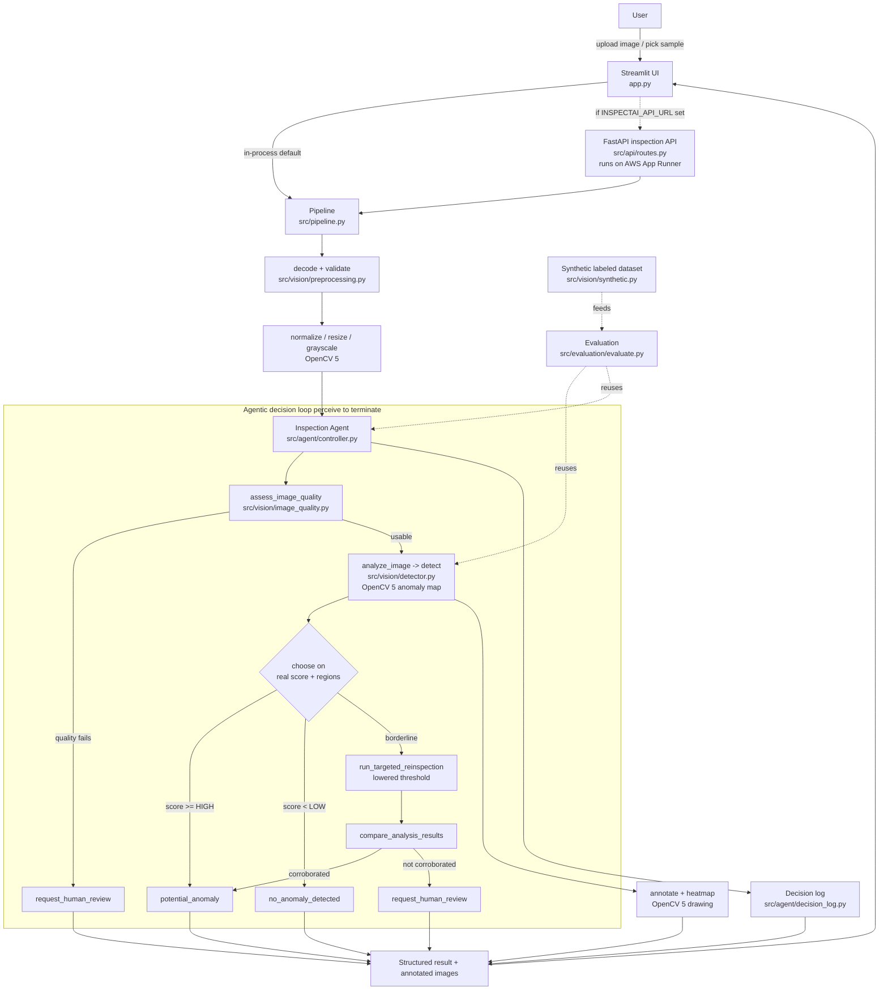

# InspectAI — Architecture

This diagram matches the implemented code, not an aspirational design. Every
box maps to a module in `src/`.

## Component flow



## Where things run

| Concern | Location |
|---|---|
| Image processing (decode, resize, color, residual, morphology, draw) | OpenCV 5 in `src/vision/*` |
| Agent decisions + bounded loop | `src/agent/controller.py` (pure, deterministic) |
| Decision trace / logging | `src/agent/decision_log.py` |
| HTTP service (the AWS component) | `src/api/routes.py` → container → App Runner |
| UI | `app.py` (Streamlit), in-process or calling the API |
| Metrics / charts | `src/evaluation/*`, `scripts/make_charts.py` |

## AWS services actually used

Only what the component needs:

- **Amazon ECR** — stores the container image.
- **AWS App Runner** — runs the container, provides HTTPS + health checks + autoscaling.

No database, queue, or GPU is used; the classical pipeline is CPU-light
(~5–10 ms/image measured locally). See `deployment/aws-deployment.md` for the
exact (currently **unverified**) deployment commands.
```
